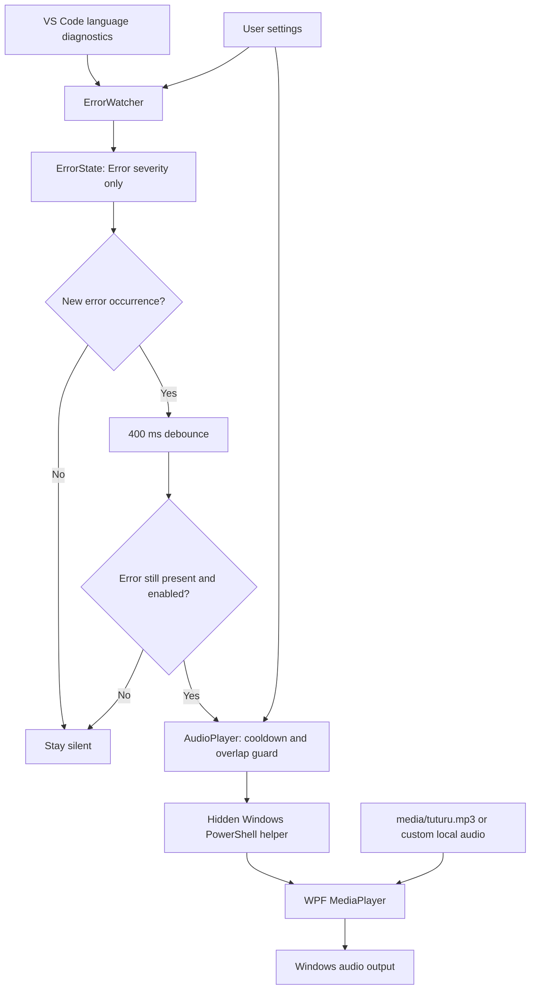

# Tuturuify architecture

Tuturuify is a local Windows VS Code extension written in TypeScript, compiled to CommonJS
JavaScript. pnpm manages development dependencies. Biome handles linting, formatting, and
import organization. The extension has no backend, database, telemetry, or runtime npm dependencies.

## Event flow



## Layout

```text
tuturuify/
  .github/workflows/ci.yml  Windows CI: checks, tests, VSIX build, artifact upload
  .vscode/                 F5 launch, compile tasks, Biome editor setup
  docs/ARCHITECTURE.md      Component and lifecycle documentation
  media/tuturu.mp3          Default bundled audio
  scripts/playSound.ps1    Windows media playback helper
  scripts/package.cjs      Create releases/ and package using the manifest version
  src/
    extension.ts           Activation, commands, logging, and component wiring
    configuration.ts       Read/clamp settings and resolve the audio path
    errorState.ts          Pure error tracking and pending-error state
    errorWatcher.ts        VS Code events, debounce, and final revalidation
    audioPlayer.ts         File checks, cooldown, subprocess playback, disposal
  test/errorState.test.ts   Detection regression tests
  dist/                    Generated extension JavaScript
  out-tests/               Generated test JavaScript
  releases/                Generated VSIX packages
  package.json             Extension manifest, settings, commands, pnpm scripts
  pnpm-lock.yaml           Reproducible dependency versions
  tsconfig*.json           Production and test TypeScript compilation
  biome.json               Biome lint and formatting configuration
  .vscodeignore            Exclude development files from VSIX
```

## Lifecycle and ownership

`activate(context)` creates the output channel, player, and watcher. It registers the Test Sound,
Choose Sound, and Toggle Error Sound commands. Every component and event subscription is
registered with `context.subscriptions`, so VS Code can dispose them on shutdown or reload.
The watcher clears its timer; the player terminates its active child process.

`extensionKind: ["ui"]` keeps the extension on the local desktop so sound is emitted by the
user's Windows machine even when a workspace is remote. Browser-hosted VS Code and other
desktop operating systems are outside this version's supported playback targets.

The watcher takes an initial diagnostic snapshot without playing. Each diagnostic event updates
only the affected resources. A global debounce merges bursts into one playback request. Before
requesting audio, it reads the pending resources again to confirm that an error still exists.
Changing Tuturuify settings cancels pending work and refreshes the baseline. Turning automatic
playback off also stops any current sound.

## Error identity

Errors are tracked independently per document URI. Each identity combines diagnostic source,
code, and message. Location is excluded so an unchanged error shifted by edits stays silent.
Occurrence counts detect an additional identical error. Pending occurrences retain the minimum
count required to distinguish a new error from the baseline; fixing that new occurrence before
the debounce prevents a sound even if an older identical error remains.

If one occurrence disappears and an identical one appears elsewhere in the same resource in
the same update, its count and identity remain unchanged, so it stays silent. Language servers
that clear and republish diagnostics can make an existing error appear new. Diagnostics first
published after activation are considered new; there is no attempt to infer user edits or crashes
from raw text or console output.

## Audio boundary

AudioPlayer checks the platform, allowed extension, and file existence. It drops overlapping
requests and requests inside the cooldown; it does not build a playback queue. Manual Test Sound
bypasses the automatic cooldown and enabled setting, while still preventing overlap.

The sound path and volume are passed as separate subprocess arguments with `shell: false`.
The helper uses `Resolve-Path -LiteralPath`, an STA dispatcher, and WPF MediaPlayer events to
wait for completion or report a decode failure. The process window is hidden. A 60-second helper
timeout and 65-second parent timeout prevent a stuck decoder from leaving playback busy forever.

Custom sound paths are application-level settings, so a workspace cannot supply that setting.
Choosing a sound changes the user setting without moving the file. Automatic failures go to the
Tuturuify output channel; manual failures also show an error message.

## Build and delivery

TypeScript outputs `dist/extension.js`, which is the manifest entry point. Production compilation
includes only `src/`; tests compile separately into `out-tests/` and use Node's built-in test runner.
VS Code itself supplies the `vscode` runtime API; `@types/vscode` is only a development dependency.

`pnpm package` compiles TypeScript and runs the official VS Code packaging tool with
`--no-dependencies`, because there are no runtime npm libraries. Compilation is part of the
pnpm package script instead of a `vscode:prepublish` hook, which VSCE invokes through npm or yarn.
The VSIX includes compiled JavaScript, the playback helper, audio,
manifest, README, changelog, and code license. Source, tests, editor configuration, and development
dependencies are excluded. Marketplace publishing is a separate future step.

The GitHub Actions workflow performs these checks on Windows with Node.js 22 and the manifest's
pnpm version. It uses a frozen lockfile and uploads successful VSIX builds for 14 days. Hosted CI
runs the diagnostic regression tests; audio playback is verified in a local desktop session.

## API references

- [VS Code diagnostics API](https://code.visualstudio.com/api/references/vscode-api#languages)
- [VS Code extension anatomy](https://code.visualstudio.com/api/get-started/extension-anatomy)
- [VS Code extension packaging](https://code.visualstudio.com/api/working-with-extensions/publishing-extension)
- [Biome quick start](https://biomejs.dev/installation/quick-start/)
- [Windows WPF MediaPlayer](https://learn.microsoft.com/en-us/dotnet/api/system.windows.media.mediaplayer)
